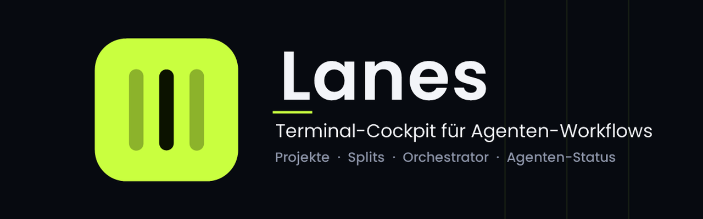
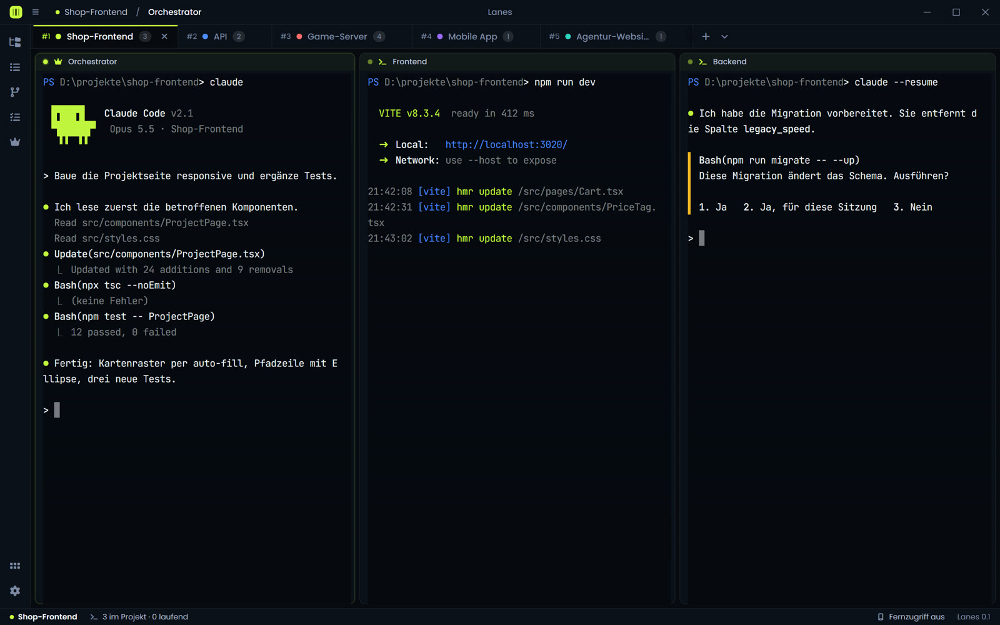
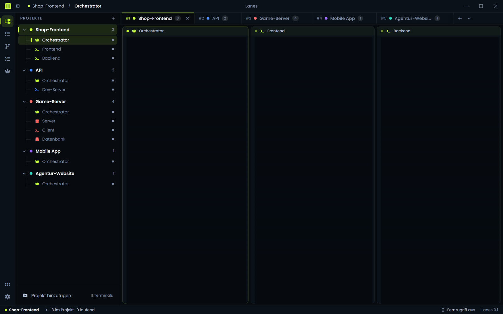
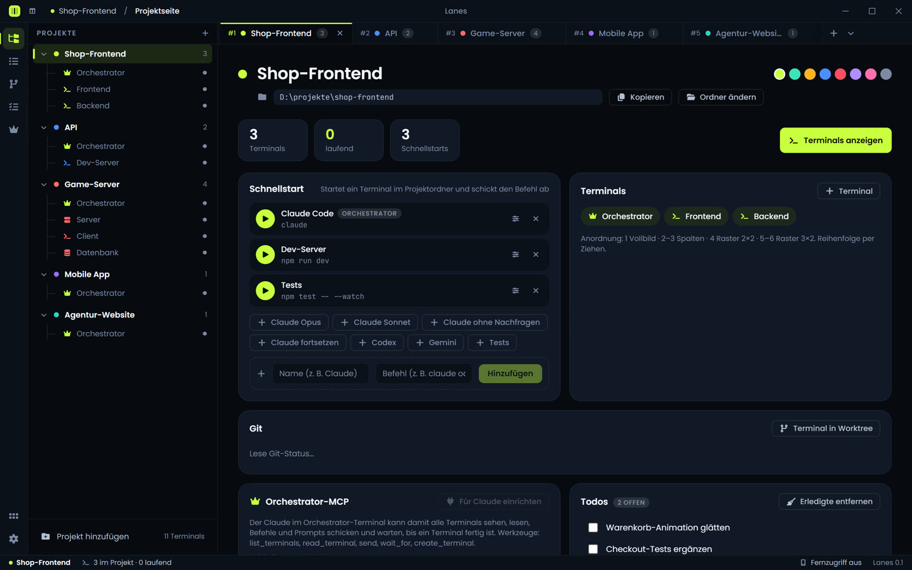
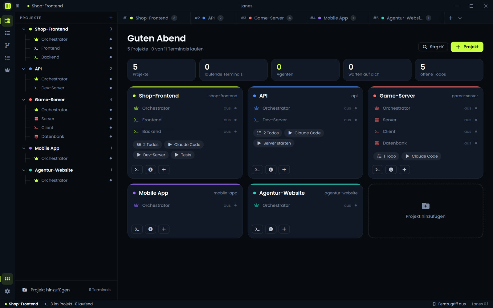
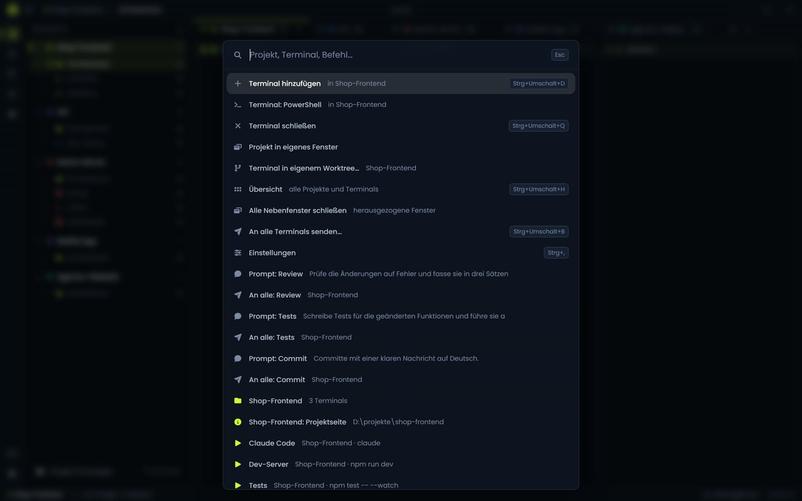
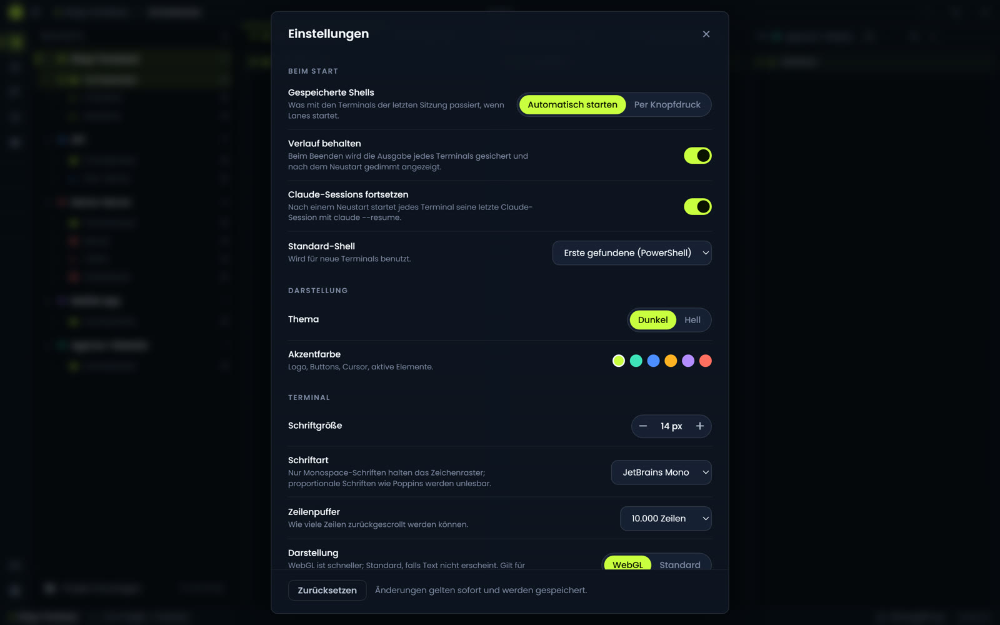

<p align="center">
  
</p>

<h1 align="center">Lanes</h1>

<p align="center">
  <strong>Terminal-Cockpit für Agenten-Workflows unter Windows</strong>
</p>

<p align="center">
  <a href="https://github.com/lanes-app/lanes/releases/latest"></a>
  
  
</p>

<p align="center">
  <a href="https://github.com/lanes-app/lanes/releases/latest/download/Lanes-Setup.exe"><strong>Lanes für Windows herunterladen</strong></a>
  <br>
  <sub>Lanes-Setup.exe · Windows 10/11, 64-bit · <a href="https://github.com/lanes-app/lanes/releases">alle Versionen</a></sub>
</p>

<p align="center">
  
</p>

---

## Inhalt

- [Was ist Lanes?](#was-ist-lanes)
- [Funktionen](#funktionen)
- [Installation](#installation)
- [Erste Schritte](#erste-schritte)
- [Tastenkürzel](#tastenkürzel)
- [Datenschutz und Sicherheit](#datenschutz-und-sicherheit)
- [Häufige Fragen](#häufige-fragen)
- [Feedback und Fehler](#feedback-und-fehler)
- [Lizenz](#lizenz)

---

## Was ist Lanes?

Lanes ist ein Terminal-Programm für Windows, gebaut für alle, die mit Claude Code und anderen
KI-Agenten auf der Kommandozeile arbeiten. Statt vieler verstreuter Fenster ordnet Lanes deine
Arbeit nach Projekten: Jedes Projekt ist ein Tab, darin laufen bis zu sechs Terminals
nebeneinander. Lanes erkennt, ob ein Agent gerade arbeitet, fertig ist oder auf deine Antwort
wartet, und meldet sich, sobald du gebraucht wirst. Lanes ersetzt keinen Agenten, sondern ist
der Ort, an dem alle deine Agenten und Terminals übersichtlich zusammenlaufen.

---

## Funktionen

### Projekte und Terminals

Ein **Projekt** ist ein Ordner auf deiner Festplatte und alles, was dazugehört. Jedes Projekt
erscheint als eigener Tab in der Titelleiste und in der Seitenleiste mit seinen Terminals.
Jedes Terminal startet im Projektordner.

- Bis zu **sechs Terminals pro Projekt**, fest angeordnet nach Anzahl:
  1 Terminal im Vollbild, 2–3 als gleich breite Spalten (Trenner ziehbar), 4 als Raster 2×2,
  5–6 als Raster 3×2.
- Reihenfolge per Ziehen ändern, auch über Projektgrenzen hinweg.
- Jedes Terminal lässt sich einzeln **personalisieren**: Name, Farbe, Icon, Startordner und Shell.
- Projekte bekommen eine Farbe, Schnellstart-Befehle (z. B. „Claude Code" → `claude`) und Notizen
  auf einer eigenen **Projektseite**.
- Ein Projekt-Tab lässt sich in ein **eigenes Fenster** ziehen, etwa für einen zweiten Monitor
  (experimentell).

<p align="center">
  
</p>

### Orchestrator und Agenten-Status

Jedes Projekt hat genau ein **Orchestrator-Terminal**, erkennbar an der Krone. Hier gibst du die
Anweisungen, zum Beispiel an Claude Code. Welches Terminal Orchestrator ist, legst du per
Rechtsklick fest.

Lanes liest die Ausgabe jedes Terminals mit und zeigt den Zustand als **Statuslicht**:

| Status | Bedeutung |
|---|---|
| **arbeitet** | Ausgabe läuft, der Agent ist beschäftigt |
| **wartet** | Der Agent braucht eine Entscheidung, etwa eine Freigabe oder eine Antwort |
| **fertig** | Der Agent ist durch, das Ergebnis wurde noch nicht angesehen |
| **bereit** | Die Shell wartet am Prompt |

Wartet ein Agent auf dich oder ist er fertig, meldet Lanes das zusätzlich über eine
**Windows-Benachrichtigung**. So kannst du mehrere Agenten parallel laufen lassen, ohne ständig
nachzusehen.

### Orchestrator-MCP für Claude Code

Lanes bringt einen eigenen MCP-Server mit. Damit kann der Claude im Orchestrator-Terminal die
anderen Terminals des Projekts selbst steuern: Aufgaben verteilen, Ergebnisse einsammeln und
warten, bis ein Worker fertig ist.

| Werkzeug | Funktion |
|---|---|
| `list_terminals` | Listet alle Terminals mit Projekt, Name, Rolle, erkanntem Agenten und Status |
| `read_terminal` | Liest die letzten Zeilen der Ausgabe eines Terminals (ohne Farbcodes) |
| `send` | Tippt Text oder einen Befehl in ein Terminal, standardmäßig mit Enter; für einen Agenten ist das ein Prompt |
| `wait_for` | Wartet, bis ein Terminal einen Zustand erreicht, und liefert dann Status und letzte Zeilen |
| `create_terminal` | Legt ein neues Terminal an, optional mit Startbefehl (z. B. `claude`) |

Der Server läuft nur lokal auf `127.0.0.1` (ab Port 41414) und ist mit einem Token geschützt.
Eingerichtet wird er mit einem Klick auf **„Für Claude einrichten"** auf der Orchestrator-Karte
der Projektseite, alternativ von Hand:

```
claude mcp add -s user --transport http lanes <Adresse von der Projektseite>
```

### Claude-Sessions fortsetzen

Lanes merkt sich pro Terminal die zuletzt erkannte Claude-Code-Session. Nach einem Neustart von
Lanes oder des Rechners kann jedes Terminal seine Session automatisch mit `claude --resume`
fortsetzen, statt mit einer leeren Shell zu beginnen. Das Verhalten lässt sich in den
Einstellungen ein- und ausschalten.

### Git-Worktrees und Sicherungspunkte

- **Terminal in eigenem Worktree:** Ein Terminal kann in einem eigenen Git-Worktree mit eigenem
  Branch starten. So arbeiten mehrere Agenten im selben Repository, ohne sich gegenseitig
  Dateien zu überschreiben.
- **Git-Karte** auf der Projektseite und Git-Panel mit Branch und Änderungen.
- **Sicherungspunkte:** Lanes sichert den aktuellen Stand der Dateien, ohne den Arbeitsbaum
  anzufassen. Bevor ein Agent größere Änderungen macht, legst du einen Punkt an und kannst später
  dorthin zurück.

<table>
  <tr>
    <td width="50%"></td>
    <td width="50%"></td>
  </tr>
  <tr>
    <td align="center"><sub>Projektseite: Schnellstarts, Terminals, Git, Orchestrator-MCP, Todos</sub></td>
    <td align="center"><sub>Dashboard: alle Projekte auf einen Blick</sub></td>
  </tr>
</table>

### Prompts und Broadcast

- **Prompt-Bibliothek:** Häufig genutzte Prompts und Befehle speichern, global oder nur für ein
  Projekt, und per Klick oder über die Kommandopalette in ein Terminal schicken.
- **Broadcast:** Einen Prompt an alle Terminals eines Projekts gleichzeitig senden
  (Strg+Umschalt+B).
- **Agentenprofile:** Schnellstarts mit Modell, Flags und Umgebungsvariablen, mit Vorlagen
  für Claude (Opus, Sonnet, fortsetzen), Codex und Gemini.

### Hooks

Hooks führen automatisch einen Befehl aus, wenn etwas passiert: wenn ein Terminal startet, ein
Agent auf dich wartet, ein Agent fertig ist oder sich beendet. Der Befehl wird entweder in das
betroffene Terminal getippt oder unsichtbar im Projektordner ausgeführt.

### Todos

Jedes Projekt hat eine eigene Todo-Liste neben den Notizen. Offene Todos erscheinen auch im
Dashboard.

### Dashboard

Das Dashboard (Klick auf das Logo oder Strg+Umschalt+H) zeigt alle Projekte als Karten: laufende
Terminals, aktive Agenten, wer auf dich wartet, offene Todos und Schnellstarts.

### Kommandopalette

Mit **Strg+K** erreichst du fast alles per Tastatur: Projekte und Terminals anspringen, Terminals
hinzufügen oder schließen, Schnellstarts ausführen, gespeicherte Prompts senden, ein Terminal in
einem Worktree öffnen oder die Einstellungen aufrufen.

<table>
  <tr>
    <td width="50%"></td>
    <td width="50%"></td>
  </tr>
  <tr>
    <td align="center"><sub>Kommandopalette (Strg+K)</sub></td>
    <td align="center"><sub>Einstellungen (Strg+,)</sub></td>
  </tr>
</table>

### Fernzugriff vom Handy

Auf Wunsch startet Lanes eine kleine Web-Seite im lokalen Netz, die du im Handy-Browser öffnest
(gleiches WLAN). Dort siehst du den Status aller Terminals, verfolgst die Ausgabe live und kannst
Eingaben und Freigaben tippen, etwa Enter, Esc, Pfeiltasten oder Strg+C.

- Standardmäßig **aus**, einschalten unter Einstellungen › Fernzugriff.
- Die Adresse enthält einen Zugangs-Token; mit „Neuer Token" sperrst du alte Zugänge.
- Optional kann zusätzlich ein temporärer Zugangscode verlangt werden, der nur im Arbeitsspeicher
  liegt und nie gespeichert wird.
- Wichtig: Der Fernzugriff ist **nicht verschlüsselt**. Siehe
  [Datenschutz und Sicherheit](#datenschutz-und-sicherheit).

### Discord Rich Presence

Wer möchte, kann in Discord anzeigen lassen, dass er gerade mit Lanes arbeitet: wahlweise mit
Projektname oder nur allgemein, dazu Terminals und Agenten-Status. Pfade und Terminal-Inhalte
werden nie gesendet. Die Funktion ist standardmäßig aus und verbindet sich nur mit dem lokal
laufenden Discord.

### Wiederherstellung nach Neustart

Projekte, Terminals, Namen, Farben, Ordner und Anordnung werden gespeichert. Beim nächsten Start
laufen die Shells entweder automatisch wieder an oder per Knopfdruck, ganz wie du es einstellst.
Auf Wunsch sichert Lanes beim Beenden auch den Verlauf jedes Terminals und zeigt ihn nach dem
Neustart gedimmt wieder an. Beendete Shells lassen sich direkt im Terminal neu starten.

### Darstellung

- Hell- und Dunkelmodus.
- Wählbare Akzentfarbe: Lime, Mint, Himmel, Amber, Violett oder Koralle.
- Schriftart und Schriftgröße für das Terminal, Zeilenpuffer, blinkender Cursor,
  „Markieren kopiert", Darstellung per WebGL oder Standard.
- Tray-Symbol, Mini-Modus und CPU- und RAM-Anzeige der Terminal-Prozesse in der Statusleiste.

---

## Installation

**Systemvoraussetzungen:** Windows 10 oder 11 (64-bit) und Microsoft Edge WebView2. WebView2 ist
unter Windows 11 bereits vorinstalliert.

1. **Installer herunterladen:**
   [Lanes-Setup.exe](https://github.com/lanes-app/lanes/releases/latest/download/Lanes-Setup.exe)
   (immer die neueste Version).
2. **Installer starten.** Lanes ist derzeit noch nicht digital signiert. Windows SmartScreen zeigt
   deshalb beim ersten Start den Hinweis „Der Computer wurde durch Windows geschützt".
   Klicke auf **„Weitere Informationen"** und dann auf **„Trotzdem ausführen"**.
3. **Installation abschließen** und Lanes über das Startmenü öffnen.

> **Hinweis zu Smart App Control:** Ist auf deinem Rechner Smart App Control aktiv, blockiert
> Windows unsignierte Programme vollständig, ohne die Möglichkeit „Trotzdem ausführen". Lanes
> lässt sich in diesem Fall erst installieren, wenn eine signierte Version erscheint.

### Update

Lade den neuen Installer herunter und installiere ihn einfach über die bestehende Version.
Projekte und Einstellungen bleiben erhalten. Was sich geändert hat, steht unter
[Releases](https://github.com/lanes-app/lanes/releases).

### Deinstallation

Windows-Einstellungen › Apps › Installierte Apps › **Lanes** › Deinstallieren.

---

## Erste Schritte

1. **Projekt anlegen:** Klicke in der Seitenleiste auf „Projekt hinzufügen" und wähle den Ordner
   deines Projekts. Lanes legt dazu einen Tab mit dem ersten Terminal an, dem Orchestrator.
2. **Terminal hinzufügen:** Über das Plus am Projekt, das Plus in der Tab-Leiste oder mit
   Strg+Umschalt+D. Gib jedem Terminal per Doppelklick einen Namen, etwa „Frontend" oder
   „Backend".
3. **Claude im Orchestrator starten:** Tippe im Orchestrator-Terminal `claude` oder lege auf der
   Projektseite einen Schnellstart dafür an. Ab jetzt zeigt das Statuslicht, ob Claude arbeitet,
   wartet oder fertig ist.
4. **Orchestrator-MCP einrichten:** Öffne die Projektseite (Info-Symbol am Projekt) und klicke
   auf der Karte „Orchestrator-MCP" auf **„Für Claude einrichten"**. Danach kann Claude im
   Orchestrator die anderen Terminals sehen, lesen und steuern. Ein bereits laufendes Claude muss
   dafür einmal neu gestartet werden.

---

## Tastenkürzel

| Kürzel | Aktion |
|---|---|
| Strg + Umschalt + T | Terminal hinzufügen |
| Strg + Umschalt + W | Alle Terminals des Projekts schließen |
| Strg + Umschalt + D | Terminal hinzufügen (Split) |
| Strg + Umschalt + Q | Terminal schließen |
| Alt + 1 … 9 | Projekt direkt anspringen |
| Strg + Tab | Nächster Tab |
| Strg + Umschalt + C / V | Kopieren / Einfügen |
| Strg + , | Einstellungen |
| Strg + K | Kommandopalette |
| Strg + B | Panel ein-/ausblenden |
| Strg + Umschalt + B | An alle Terminals senden (Broadcast) |
| Strg + Umschalt + H | Dashboard (Übersicht) |
| Projekt-Tab ziehen | aus dem Fenster: eigenes Fenster · auf ein Terminal: dort anhängen |

---

## Datenschutz und Sicherheit

- **Alles bleibt lokal.** Projekte, Einstellungen, Verlauf und Sessions liegen auf deinem Rechner
  unter `%APPDATA%\app.lanes.desktop`.
- **Keine Telemetrie, keine Konten.** Lanes sendet keine Nutzungsdaten und braucht keine
  Anmeldung.
- **Opt-in für alles, was nach außen geht.** Fernzugriff und Discord Rich Presence sind
  standardmäßig ausgeschaltet. Discord erhält nie Pfade oder Terminal-Inhalte.
- **Saubere Prozesse.** Jede Shell läuft in einem Windows-Job-Objekt. Schließt du ein Terminal oder
  Lanes, werden die Shell und alle von ihr gestarteten Programme zuverlässig mit beendet.
- **Orchestrator-MCP nur lokal.** Der MCP-Server lauscht ausschließlich auf `127.0.0.1` und
  verlangt einen Token, der nur auf deinem Rechner liegt.
- **Fernzugriff nur in vertrauten Netzen.** Die Handy-Seite läuft über unverschlüsseltes HTTP im
  lokalen Netz (ab Port 41424). Schalte sie nur in Netzen ein, denen du vertraust, etwa zu Hause,
  oder nutze sie über ein VPN wie Tailscale. Der Zugang ist durch einen Token in der Adresse
  geschützt, wiederholte Fehlversuche werden gesperrt, und optional kann ein temporärer
  Zugangscode verlangt werden.

---

## Häufige Fragen

<details>
<summary><strong>Ist Lanes kostenlos?</strong></summary>

Ja. Lanes ist kostenlos nutzbar, ohne Konto und ohne Abo.
</details>

<details>
<summary><strong>Ist Lanes Open Source?</strong></summary>

Nein. Lanes ist kostenlos, aber keine Open-Source-Software. Dieses Repository enthält nur die
Beschreibung, Bilder und die Releases zum Herunterladen, keinen Quellcode.
</details>

<details>
<summary><strong>Warum warnt Windows beim Installieren?</strong></summary>

Die EXE ist noch nicht digital signiert. Windows SmartScreen zeigt deshalb bei unbekannten
Programmen einen Hinweis. Über „Weitere Informationen" › „Trotzdem ausführen" geht es weiter.
Ist Smart App Control aktiv, blockiert Windows unsignierte Programme vollständig.
</details>

<details>
<summary><strong>Welche Shells werden unterstützt?</strong></summary>

PowerShell 7, Windows PowerShell, Eingabeaufforderung (cmd), Git Bash und WSL. Lanes erkennt
automatisch, was auf deinem Rechner installiert ist, und bietet nur diese Shells an. Die
Standard-Shell für neue Terminals legst du in den Einstellungen fest.
</details>

<details>
<summary><strong>Funktioniert Lanes auch mit anderen Agenten als Claude Code?</strong></summary>

Ja. Lanes ist ein vollwertiges Terminal, du kannst darin jedes Kommandozeilen-Programm nutzen.
Für den Agenten-Status erkennt Lanes neben Claude Code auch OpenAI Codex, Gemini CLI, Aider und
OpenCode. Claude-spezifisch sind das Fortsetzen von Sessions und die Einrichtung des
Orchestrator-MCP per Klick.
</details>

<details>
<summary><strong>Gibt es Lanes für macOS oder Linux?</strong></summary>

Noch nicht. Versionen für weitere Systeme sind geplant, aktuell ist Lanes nur für Windows 10 und
11 verfügbar.
</details>

<details>
<summary><strong>Wo speichert Lanes meine Daten?</strong></summary>

Ausschließlich lokal unter `%APPDATA%\app.lanes.desktop`. Es gibt keine Cloud und kein Konto.
</details>

---

## Feedback und Fehler

Fehler gefunden oder eine Idee für Lanes? Eröffne ein
[Issue](https://github.com/lanes-app/lanes/issues). Hilfreich sind dabei die Lanes-Version
(unten rechts in der Statusleiste), deine Windows-Version, die verwendete Shell und eine kurze
Beschreibung, wie sich der Fehler nachstellen lässt.

---

## Lizenz

Lanes ist kostenlos nutzbar, aber keine Open-Source-Software. Der Quellcode ist nicht öffentlich.
Alle Rechte vorbehalten.

---

<p align="center">
  <sub>© 2026 Lanes</sub>
</p>
